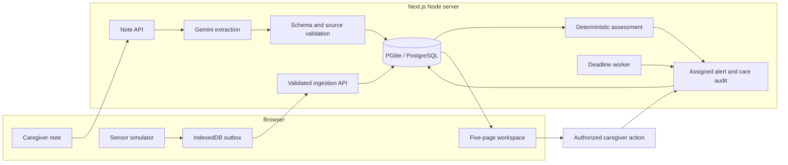

# WardZero

**Care with continuity.** A solo-built home-care monitoring prototype for Operation Ward Zero.

WardZero connects simulated vital signs and English caregiver observations to explained concern, an assigned alert and a recorded human response. It also demonstrates what happens when sensor connectivity fails or nobody acknowledges an alert.

[Open the browser app](https://satwiksharma01.github.io/wardzero/) · [Quick start](#quick-start) · [Architecture](#architecture) · [Testing](#testing)

All patients, caregivers, readings and notes are synthetic. This is an engineering prototype, with no clinical validation or demonstrated 24–48-hour prediction.

## What it does

- Displays oxygen saturation, heart rate, temperature and respiratory rate with units, trends and separate observation/receipt times.
- Uses live Gemini to extract bounded observations from caregiver notes, retaining literal excerpts, negation, time context and analysis status.
- Combines eligible notes and fresh vitals through deterministic, versioned rules. The model does not directly assign concern or perform care actions.
- Tracks assigned alerts through acknowledgement, recorded action and resolution, preserving an audit history.
- Buffers sensor readings in IndexedDB before transmission. Queues survive refresh; idempotent retries recover lost acknowledgements without duplicating readings.
- Escalates unanswered alerts to a backup coordinator through a server worker, including when every browser page is closed.
- Provides isolated demo runs, labeled time advances and read-only archives for repeatable demonstrations.

## Workspace pages

| Page          | Route           | Purpose                                                        |
| ------------- | --------------- | -------------------------------------------------------------- |
| Overview      | `/`             | Patient summary, vital cards, trend and next care actions.     |
| Vitals        | `/vitals`       | Measurement selection, charts and reading log.                 |
| Care response | `/care`         | Assigned episodes, coordinator inbox and response history.     |
| Observations  | `/observations` | Caregiver notes, extraction state and source evidence.         |
| Simulation    | `/simulation`   | Sensor generation, scenarios, queue recovery and run controls. |

A shared layout owns patient polling, identity, sensor timers and draft state. Client navigation keeps streaming, pending request identities and drafts intact. Full refresh restores durable database/outbox data; unsaved text is only preserved across client navigation.

## Tech stack

| Layer            | Implementation                                                               |
| ---------------- | ---------------------------------------------------------------------------- |
| App and API      | Next.js 16.4.5, React 19.3.1, TypeScript 5.9.3.                              |
| Interface        | Tailwind CSS 4.3.5, customized shadcn/ui, Radix primitives and Lucide icons. |
| Database         | Filesystem-backed PGlite 0.5.15, an embedded PostgreSQL runtime.             |
| Validation       | Zod schemas, server-side authorization and parameterized SQL.                |
| AI               | Server-only Gemini integration through its OpenAI-compatible endpoint.       |
| Sensor buffering | Native IndexedDB with bounded retry/backoff.                                 |
| Verification     | Vitest, Playwright with installed Chrome, and axe.                           |

Exact dependency resolutions are pinned in [package-lock.json](package-lock.json).

## Quick start

### GitHub Pages app

Open **[satwiksharma01.github.io/wardzero](https://satwiksharma01.github.io/wardzero/)** to run the five-page app without installing anything. Activate Ananya's identity, open Simulation and load a stable baseline. Then use the sample note in Observations or load deterioration to try the care response. Disconnect/reconnect the sensor to inspect its persistent queue, or advance the demo clock to demonstrate escalation to Ravi.

The Pages build reuses the workspace components, PostgreSQL schema, reading store, deterministic rules, evidence validation and care transitions. PGlite runs in a Web Worker and persists to IndexedDB on the visitor's device; its leader election coordinates multiple tabs. Client navigation uses query URLs such as `?page=vitals`, so direct links and refresh work under GitHub's repository path.

**This is a browser-local demonstration.** Data is not shared between devices. The exact sample `More tired today and barely ate lunch.` uses an explicitly labeled fixed interpretation, not a live model. Other notes are saved with analysis Unavailable. No Gemini key, email credentials or local patient database is published. Deadlines are checked while the app is open and on reopening; no monitoring runs after all its tabs close. Clearing site data removes that browser's history. Use a current browser that supports IndexedDB, Web Workers, WebAssembly and Web Crypto.

To reproduce the Pages build:

```sh
npm ci
npm run build:pages
npm run preview:pages
```

The preview command prints its local URL. Output lives in ignored `.data/pages/`; only that generated bundle is uploaded. [The Pages workflow](.github/workflows/pages.yml) runs checks and browser journeys before deploying pushes to `main`. It also supports manual runs. Repository Settings → Pages must use **GitHub Actions** as the build source. Reverting a deployment commit on `main` and letting the workflow run redeploys the previous source.

The following instructions run the full Next.js server app with optional live Gemini.

### Requirements

- Node.js 22 and npm 11; verified with Node 22.14.0 and npm 11.4.0 on Windows.
- A writable local directory. No external PostgreSQL account is needed.
- Installed Chrome for the current browser-test configuration.
- A Gemini key only if you want live note analysis. Reading-based assessment works without it.

### Install and run

```sh
git clone https://github.com/satwiksharma01/wardzero.git
cd wardzero
npm ci
npm run dev
```

Open [http://127.0.0.1:3000](http://127.0.0.1:3000). Initial patient history is empty; use Simulation to generate readings.

To configure local settings, copy [.env.example](.env.example) to `.env.local`:

```powershell
# Windows PowerShell
Copy-Item .env.example .env.local
```

On macOS/Linux, use `cp .env.example .env.local`. Keep real keys in this ignored file, then restart the server.

```dotenv
WARDZERO_DATA_NAME=wardzero
WARDZERO_AI_PROVIDER=gemini
WARDZERO_AI_MODEL=gemini-3.5-flash-lite
WARDZERO_AI_API_KEY=your-private-key
```

Without provider configuration, notes explicitly show Unavailable. Failed interpretation remains visible and adds no observations; there is no hidden mock fallback in the normal app. Normal browser regression tests configure their own mock provider separately.

`npm run dev` selects Next.js's supported webpack development mode after repeated Turbopack HMR reloads in the verified Windows environment. Production builds use Turbopack. The exact development-framework trigger remains unproven. `.npmrc` disables dependency lifecycle scripts; the verified installation/build does not require blanket enabling them.

### Production build

Stop the development server before starting production against the same database:

```sh
npm run build
npm start
```

The server remains bound to `127.0.0.1`. Set `PORT` to use another port. On Windows, for example: `$env:PORT='3108'` followed by `npm start`.

### Storage and configuration

The default database is `.data/wardzero`. Migrations run automatically. Run only one app process per database name; use different `WARDZERO_DATA_NAME` values for isolated instances. Preserve this directory to retain patient/run history. Creating a new demo run archives existing evidence rather than deleting it.

| Variable                                   | Purpose/default                                                                                                   |
| ------------------------------------------ | ----------------------------------------------------------------------------------------------------------------- |
| `WARDZERO_DATA_NAME`                       | Local database directory name; default `wardzero`. Letters, digits, underscores and hyphens only.                 |
| `WARDZERO_AI_PROVIDER`                     | Optional `gemini`, `openai` or `ollama` adapter.                                                                  |
| `WARDZERO_AI_MODEL`                        | Structured-output model; verified Gemini example above.                                                           |
| `WARDZERO_AI_API_KEY`                      | Server-side provider credential. Never use a `NEXT_PUBLIC_` variable.                                             |
| `WARDZERO_AI_BASE_URL`                     | Optional provider override; use HTTPS except for loopback development. Gemini selects its endpoint automatically. |
| `WARDZERO_ACK_DEADLINE_MS`                 | Acknowledgement deadline; default 120,000 ms. Test/demo range: 1,000–900,000 ms.                                  |
| `WARDZERO_EMAIL_ENABLED`                   | Optional email; disabled unless explicitly set to `true` with complete configuration.                             |
| `WARDZERO_EMAIL_API_KEY`                   | Optional Resend credential.                                                                                       |
| `WARDZERO_EMAIL_FROM`, `WARDZERO_EMAIL_TO` | Verified sender and authorized recipient.                                                                         |
| `WARDZERO_EMAIL_ENDPOINT`                  | Optional restricted Resend/loopback test endpoint override.                                                       |

Email acceptance is separate from delivery, reading and caregiver acknowledgement. The project has only tested a loopback receiver, not real cloud delivery. Disabled jobs do not activate retroactively. In-app escalation works without email configuration.

## Try the care flow

1. Activate Ananya, the primary caregiver, in the shared identity bar. Open Simulation and create a new demo run.
2. Load a stable baseline or send three stable readings. Concern becomes Low when sufficient distinct observations are present.
3. Open Observations and save: `More tired today and barely ate lunch.` With configured Gemini, eligible extracted observations raise concern to Medium. Inspect the literal excerpts and evidence links.
4. Load deterioration in Simulation. The same active episode can rise to High. Open Care response, acknowledge, record an action, then resolve with a separate reason. Resolution does not alter the measured concern.
5. In a new run, disconnect sensor transport, generate three readings and refresh. The queue persists. Reconnect to recover the readings with original identities and timestamps.
6. Create an unanswered-alert run, load deterioration and advance 130 visibly labeled demo seconds. Switch to Ravi, the backup coordinator, and acknowledge the escalated alert in Care response.

Freshness, concern and care-response state are separate. Pausing readings eventually makes current concern Unknown while preserving recorded episodes and history. These synthetic rules are not a clinical score or treatment guidance.

## Architecture



### Data and reliability

- Readings retain `eventId`, `runId`, device/sequence, observed time, received time and explicit metric units. A repeated identity is accepted as a duplicate only when its payload matches; conflicting payloads remain explicit.
- The browser outbox stores before sending, holds at most 500 entries including rejected items, and sends batches of up to 50 eligible entries. Retry backoff is bounded; permanent rejections remain inspectable. Deliberate browser storage clearing/eviction is outside the durability claim.
- Observation time drives measurement history and freshness. Any reading ahead of its source run's clock is rejected; timestamps are never silently repaired. Demo freshness boundaries are 30 and 90 seconds.
- Notes are persisted before inference, outside database transactions. Only validated, current, non-negated observations contribute. Excerpts, model/prompt version, reasons and evidence IDs remain inspectable. AI output has no tool access or authority to perform care transitions.
- Assessment and alert updates are transactional. Care events use idempotency identities and server-assigned actors. Acknowledgement, action and resolution remain distinct audit events.
- Node instrumentation evaluates persisted deadlines every second. Escalation is recorded once per episode and overdue state recovers after restart. There is no continuous monitoring while the server/computer is off.
- Synthetic time advances apply consistently to run evidence, freshness and deadlines. Sessions expire against actual wall time, not the accelerated demo clock.

PGlite makes a local solo demonstration reproducible without a separate database service. It is single-process storage, so ephemeral serverless disks and multiple app instances sharing one database directory are unsuitable. Public interactive hosting requires production authentication, hosted durable storage, a supported worker and rate limiting.

### API

| Endpoint                      | Purpose                                                                                                 |
| ----------------------------- | ------------------------------------------------------------------------------------------------------- |
| `GET /api/patient`            | Current snapshot, last 60 readings, assessment/evidence, notes, recent care episodes and worker status. |
| `POST /api/readings/batch`    | Ingest 1–100 events with per-event accepted, duplicate, conflict or rejected outcomes.                  |
| `POST /api/notes`             | Save/retry a caregiver note and bounded extraction.                                                     |
| `GET /api/demo/session`       | Read the local demo identity.                                                                           |
| `POST /api/demo/session`      | Activate an allowlisted demo role.                                                                      |
| `GET /api/demo`               | List ten recent runs.                                                                                   |
| `POST /api/demo`              | Authorized, idempotent reset, seed and time-advance controls.                                           |
| `POST /api/alerts/:id/events` | Acknowledge, record an action or resolve an assigned episode.                                           |
| `GET /archive/:id`            | Read-only stored evidence for an earlier run.                                                           |

The API validates JSON schemas, limits bodies to 128,000 bytes and checks loopback Host/exact mutation Origin. Notes, care transitions and run-control commands enforce their corresponding demo-role checks; sensor ingestion does not require a caregiver session. Opaque session tokens are hashed in storage, HttpOnly/SameSite Strict and expire after eight wall-clock hours. The two selectable local identities are demonstration controls, not production sign-in. Care/session errors distinguish malformed input, expired/missing identity, unassigned actor, missing evidence and transition/idempotency conflicts.

### Project layout

```text
src/
  app/          Next.js pages, route-group layout and API routes
  client/       Sensor controller and IndexedDB outbox
  components/   Workspace, evidence, care and UI components
  domain/       Contracts, assessment and care rules
  server/       Database, migrations, stores, AI and deadline worker
  pages-demo/   Browser entry, local transport, routing and database worker
tests/          Deterministic, browser, provider and worker checks
scripts/        Recording, encoding and artifact verification
demo/           Optional presentation media and inputs; local-only, ignored
LICENSES/       Required third-party source notices
.data/          Ignored runtime databases, reports and local exports
README.md       Project documentation
```

## Testing

Start with the deterministic checks and production build:

```sh
npm test
npm run lint
npm run build
npm run typecheck
npm run test:e2e
```

The browser configuration uses installed Chrome and isolated data/ports. If Playwright cannot find Chrome, install it or select an appropriate installed channel in the configuration. Run app-owning browser/live/worker suites sequentially: they share Playwright's default report directory. Test fixtures and their databases are separate from the normal app.

| Command                           | Scope                                                                                                         |
| --------------------------------- | ------------------------------------------------------------------------------------------------------------- |
| `npm test`                        | Domain, ingestion, persistence, source-context validation, authorization and queue checks; no AI key.         |
| `npm run test:e2e`                | Chrome navigation, caregiver flow, failed drafts, outage/replay, keyboard and accessibility; local mock AI.   |
| `npm run test:pages`              | Built static app under `/wardzero/`: care flow, queue persistence, archives, multiple tabs and accessibility. |
| `npm run test:worker:production`  | Deadline escalation with all browser pages closed; build first.                                               |
| `npm run test:worker`             | Development-server version of the worker check.                                                               |
| `npm run test:email`              | Production worker against a loopback email receiver; build first. No real email.                              |
| `npm run test:ai-live`            | Opt-in 40-case synthetic Gemini evaluation, paced at least five seconds apart.                                |
| `npm run test:ai-smoke`           | Opt-in four-case Gemini smoke test.                                                                           |
| `npm run test:e2e-live`           | Opt-in actual Gemini note-to-care browser journey.                                                            |
| `npm run test:early-warning`      | Deterministic storage-backed replay and controls.                                                             |
| `npm run test:early-warning-live` | Opt-in replay using actual Gemini extraction.                                                                 |
| `npm run verify:artifact`         | Check server build traces exclude runtime data and private environment files.                                 |

Generated screenshots and JSON evidence go to ignored `.data/verification/`; browser failure traces go to `test-results/`. Live commands use the configured provider and make real requests. Never enable real email just to run the tests.

### Recorded verification and evidence

The GitHub Pages release passed 77 deterministic tests across 22 files and four static-app Chrome journeys. Five pages at three widths passed overflow, visible-notice and tagged axe checks. The journeys also cover failed database downloads, persistent queues, care responses, read-only archives and browser-worker leadership changes. The full Next.js build and its 15 private-file trace guards, TypeScript and lint checks passed. These Pages checks make no live AI or email calls.

On 8 November 2026, this README/report-path migration reran all 73 deterministic tests and 12 Chrome journeys, production compilation and trace guards, TypeScript, ESLint, formatting, the browser-closed production worker, loopback email and the actual Gemini UI journey. Relocated video playback/seek also passed, and no suite recreated the removed folder. The 40-case extractor evaluation below was not rerun for this migration.

The verified blue workspace release passed 73 deterministic tests across 21 files, 12 Chrome journeys, five pages at three widths with zero tagged axe violations, and TypeScript/ESLint/Prettier/production-build checks. Fifteen server trace manifests excluded private environment files and runtime data. Separate checks exercised actual Gemini, a browser-closed production worker and a loopback email receiver. Automated axe results do not establish complete accessibility conformance.

These historical results identify application revision `2b0e2e76b1403608c0c740bb733e8c048d49d8c8` and unchanged extractor core `d0bc83cc96eb5a1d7d5abfc76229abd33d22629e`. The detailed [workspace results](https://github.com/satwiksharma01/wardzero/blob/11cfc25d368033332e2a15d7af624e7651ff8f73/documents/verification/2026-11-07-blue-pages.md), [Gemini evaluation and failures](https://github.com/satwiksharma01/wardzero/blob/11cfc25d368033332e2a15d7af624e7651ff8f73/documents/verification/NOTE_EVALUATION.md), and [controlled replay](https://github.com/satwiksharma01/wardzero/blob/11cfc25d368033332e2a15d7af624e7651ff8f73/documents/verification/EARLY_WARNING.md) remain at their recorded Git revision.

The synthetic 40-case English-note evaluation contains 32 development examples and eight confirmation examples. Those confirmation examples were reused for the final v3 evaluation, so the results remain development-informed. Earlier model errors and provider failures remain in the linked reports. A constructed replay measured concern 45 synthetic seconds before the fixture's first individual vital threshold; model wall latency is excluded. Neither result demonstrates real-patient accuracy, clinical lead time, multilingual reliability or 24–48-hour prediction.

## Optional local recording tools

Presentation media is retained locally in ignored `demo/` and is not part of a fresh clone or the Pages deployment. The existing recording tools require local `demo/narration.json` and `demo/closing.svg` inputs before running the optional commands below. They are not needed to run either version of the app.

The existing local `demo/wardzero-demo.mp4` is 180 seconds, 1920×1080 H.264/AAC, with synthesized narration and burned-in captions. It records real UI/API/database transitions and actual Gemini against synthetic inputs. Accelerated demo time is visibly labeled; the adjacent `.sha256` file identifies the encode.

To reproduce it, install FFmpeg/FFprobe and Chrome. Narration generation additionally requires the Windows speech runtime. Start an isolated app instance with a different `WARDZERO_DATA_NAME`, a configured Gemini key and email disabled. Optionally set its `PORT` and the recording command's `WARDZERO_DEMO_URL` to the same loopback URL.

Generate narration from the repository root in PowerShell:

```powershell
Add-Type -AssemblyName System.Speech
New-Item -ItemType Directory -Force .data/demo/audio | Out-Null
$wardzeroChapters = Get-Content demo/narration.json -Raw | ConvertFrom-Json
for ($wardzeroIndex = 0; $wardzeroIndex -lt $wardzeroChapters.Count; $wardzeroIndex++) {
    $wardzeroVoice = New-Object System.Speech.Synthesis.SpeechSynthesizer
    $wardzeroVoice.SelectVoice('Microsoft Zira Desktop')
    $wardzeroVoice.Rate = 1
    $wardzeroVoice.SetOutputToWaveFile((Join-Path (Get-Location) ('.data/demo/audio/part-' + $wardzeroIndex + '.wav')))
    $wardzeroVoice.Speak($wardzeroChapters[$wardzeroIndex].text)
    $wardzeroVoice.Dispose()
}
```

Then record, encode and verify:

```sh
node scripts/record-demo.mjs
node scripts/render-demo.mjs "C:/path/to/ffmpeg.exe"
node scripts/verify-video.mjs
```

Raw capture/audio and recording checkpoints stay under `.data/demo/`; playback evidence goes to `.data/verification/`. Recording aborts if a concern, care response, recovery or escalation assertion fails. Encoding replaces `demo/wardzero-demo.mp4` and its captions; update the checksum when replacing the canonical video. No real email is sent by this walkthrough.

To export clean submission source, first create `.data/submission`, then run:

```sh
git archive --format=zip --output=.data/submission/wardzero-source.zip HEAD
```

This exports committed files only. Keep the generated ZIP local rather than adding a repository copy of the repository. Uploads and final declarations still need to be completed through the hackathon form.

## Troubleshooting

| Symptom                                         | Check                                                                                                                    |
| ----------------------------------------------- | ------------------------------------------------------------------------------------------------------------------------ |
| Empty history or Unknown concern                | Send readings in Simulation; inspect freshness and sufficient distinct evidence.                                         |
| Notes show Unavailable/Failed                   | Configure the server-side provider/key, restart, and inspect the explicit failure state. Reading rules continue to work. |
| Port already in use                             | Stop the other server or set another `PORT`. Give separate instances different database names.                           |
| Database is locked                              | Run only one process per PGlite directory; stop dev before starting production with that name.                           |
| Outbox cannot persist                           | Check browser storage availability; the simulator reports storage failures instead of silently dropping readings.        |
| Build is blocked creating a junction on Windows | Allow the build environment to create the required package junction; this is an environment permission issue.            |
| Escalation does not progress                    | Keep the Node server running and inspect its worker heartbeat; computer/server-off continuity is not implemented.        |

## AI, data and prototype boundaries

An AI coding assistant helped with planning, implementation, tests, review, documentation and demo preparation. Full-server note extraction uses the configured Gemini provider; repeatable server browser regressions use an explicitly isolated mock. The Pages app uses only its declared exact-note fixture, with no live AI. The synthetic note set is not a clinical NLP benchmark. No imported patient dataset, real patient note, credential, hardware integration, stock patient footage or music is included.

This is a single-patient prototype with a local server version and a public browser-local demo. Human caregiver usability, clinical validation and real cloud email delivery remain unperformed or unverified. It does not diagnose, recommend treatment or claim continuous monitoring while the server/computer is off. Hosting the shared server app publicly requires production identity, hosted durable storage, worker support, rate limiting and appropriate clinical governance. The Pages app's identities are local role controls, not production authentication. Publishing the app/source does not establish a Wooble submission.

## Third-party notices

Dependencies retain their upstream licenses, available through installed packages and their pinned source versions. Customized shadcn source attribution is preserved in [LICENSES/shadcn-ui.txt](LICENSES/shadcn-ui.txt). Listing dependencies does not grant a new license to this repository's original source.

| Component                                                       | License                     |
| --------------------------------------------------------------- | --------------------------- |
| Next.js, React/React DOM, Zod, Radix UI, cn, Tailwind CSS, Vite | MIT                         |
| PGlite, Playwright, class-variance-authority                    | Apache-2.0                  |
| Lucide React                                                    | ISC                         |
| axe Playwright integration                                      | MPL-2.0                     |
| shadcn/ui source                                                | MIT; notice retained above. |

The CSS requests DM Sans and Manrope from Google Fonts with Arial/sans-serif fallbacks; no font binaries are vendored. Demo narration uses the installed Microsoft Zira voice and FFmpeg encodes the footage, audio and captions.
