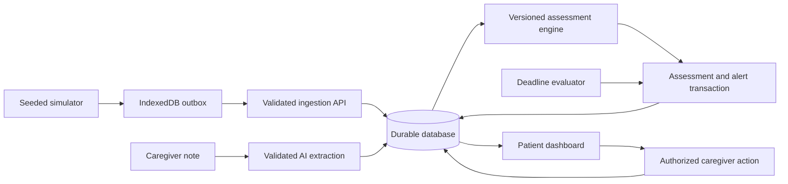

# WardZero architecture

Status: Next.js/TypeScript/PostgreSQL stack confirmed by the participant on 7 November 2026. Local milestone uses filesystem-backed PGlite (embedded PostgreSQL). Local assessment, live Gemini notes, alerts, demo sessions, caregiver response, autonomous in-app escalation, durable outbox, and isolated demo runs are implemented. Hosted PostgreSQL and production identity remain prerequisites if public interactive hosting is chosen. Actual versions are pinned in package.json/package-lock.json. See [ADR-001](decisions/001-local-postgres.md) and [ADR-002](decisions/002-explained-care-loop.md).

## Implemented stack

- TypeScript with Next.js for the interface and server API, avoiding a second backend language for a solo build.
- Filesystem-backed PGlite (embedded PostgreSQL) with parameterized SQL and five numbered migrations for a reproducible local demo.
- Browser simulator with IndexedDB outbox; it sends to the same ingestion API used by tests.
- Schema validation at every boundary; structured-output-capable AI provider behind a server-only adapter.
- Polling for current snapshot/history initially; introduce streaming only if justified.
- Focused unit/integration tests plus a small browser journey suite using familiar tools.

PGlite owns one database per Node process. This release binds to loopback and persists under ignored `.data/`. Public interactive hosting requires a separately reviewed identity system, hosted database, and supported background worker. Ephemeral serverless storage is unsuitable for this deployment.

## Data flow

AI calls occur outside database transactions. Persist the note first with Pending analysis; complete or fail analysis explicitly. Recompute assessment after validated extraction. Keep critical reading rules available independently of AI.

## Persisted records

| Record | Essential fields |
|---|---|
| Patient | Fixed synthetic identity `patient-001` in validated contracts; no real patient records. |
| DemoRun | id, scenario, createdAt, clockOffsetMs, active; idempotent command journal for seed/reset/advance. |
| Reading | eventId, patientId, runId, deviceId, sequence, observedAt, receivedAt, metrics. |
| Note | id, patientId, runId, authorId, text, recordedAt, analysis status |
| NoteAnalysis | Fields on the note: observations, source excerpts, negation/temporality, model/prompt version, failure reason. |
| Assessment | id, runId, concern, evidence IDs, reasons, evaluatedAt, latestObservedAt, ruleVersion. |
| AlertEpisode | id, patientId, runId, type, severity, state, assignedActor, openedAt, acknowledgementDueAt |
| CareEvent | id, alertId, actorId, action type, reason, occurredAt, idempotency key |
| Escalation | Persisted dueAt/escalatedAt/backup actor on alert; one audit event and separate worker heartbeat. In-app channel only. |
| Session | Opaque token hash, allowlisted demo actor, wall-time expiry. |

Store measurements with explicit units and preserve observation/receipt times separately. Add uniqueness for event identity and escalation identity. Scope reads and writes to authorized patient/run assignments.

## Local API contract

Current local slice implements `POST /api/readings/batch`, `GET /api/patient`, `GET/POST /api/demo/session`, and `POST /api/alerts/:id/events`. The snapshot includes a bounded 60-reading history, current/last assessment, and five recent alert episodes with their audit history. `POST /api/notes`, `GET/POST /api/demo`, and read-only `/archive/:id` are also implemented. General multi-patient routing remains planned.

| Endpoint | Purpose and guarantees |
|---|---|
| `POST /api/readings/batch` | Bounded batch, per-event accepted/duplicate/rejected result; same event ID and different payload is a conflict. |
| `GET /api/patient` | Latest readings, last 60 readings, current/last assessment, five recent episodes, notes, run/clock, heartbeat. |
| `POST /api/notes` | Validates size, source run, and actor; persists note before bounded model analysis. |
| `POST /api/alerts/:id/events` | Authorizes actor, checks allowed state transition, appends audit event transactionally. |
| `GET/POST /api/demo/session` | Inspect/activate an allowlisted local demo identity using an HttpOnly session cookie. |
| `GET/POST /api/demo` | List ten recent runs; primary-only idempotent reset, preset, or time advance. |
| `GET /archive/:id` | Read-only stored run evidence, including direct links older than the ten-run index. |

Mutations validate with Zod, bound JSON bodies to 128 KB, and use idempotency identities where retries are possible. Reading batches contain 1–100 events. Session/care errors distinguish 400/401/403/404/409; operational failure returns 503 without database/provider internals. Multi-patient routing and public authentication are outside this release.

## Time and concurrency

- Use UTC instants in storage and explicit timezone formatting in the UI.
- Inject a clock into simulator, assessment, and escalation logic; accelerated demos must share the same virtual clock mapping.
- Reject any reading ahead of its source run's clock (zero positive skew). No invisible future-evidence buffer exists; the simulator retains rejected entries for inspection. Never silently repair timestamps.
- Append historical readings, but recompute the current snapshot from latest valid observation time.
- Evaluate active episodes transactionally; use uniqueness/locking to prevent concurrent ingestion from opening duplicate episodes.
- Separate historical replay analysis from current alerting. Use freshness eligibility at evaluation time.

## Escalation execution

Next.js Node instrumentation starts one in-process interval, which evaluates persisted deadlines every second. Transactional writes create exactly one escalation per episode. The UI exposes the worker's last check. A browser-closed production-server test verifies independent progress.

Demo time advance also evaluates deadlines for repeatability and is visibly labeled. Database reopen tests verify overdue catch-up; there is no continuous monitoring while the server/computer is off. No SMS, call, or external delivery is claimed.

## Outbox recovery

Write generated events to IndexedDB before sending. Retry only pending/retryable events with bounded exponential backoff. Remove accepted or confirmed duplicate events after the acknowledgement is durable locally. Preserve rejected events with a reason for inspection rather than retrying forever. Show queue depth and last sync.

Set a bounded queue capacity and expose overflow explicitly. Simulated disconnect blocks the transport; also test an actual failed network request. Reload must preserve pending entries.

## AI trust boundary

Treat notes as untrusted data, including embedded instructions. Request only an allowlisted observation schema; validate enums, excerpts, length, and temporal fields. Reject unsupported excerpts. Do not grant the model tools or let its text execute state transitions. Keep keys server-side, log metadata rather than raw notes, and limit retries/timeouts and input length.

## Access and deployment

The local server validates loopback Host, exact mutation Origin, JSON type, body size, and server-assigned care roles. Session tokens are random, hashed in storage, HttpOnly/SameSite Strict, and expire after eight wall-time hours. Both identity choices are intentionally available to the local participant; this is a demonstration boundary rather than production sign-in.

Use synthetic data exclusively. A public read-only demo can be separate from authenticated write controls. Record environment variable names in future SETUP.md; never commit values. Verify persistent storage, worker support, and deployment build before recording the video.
