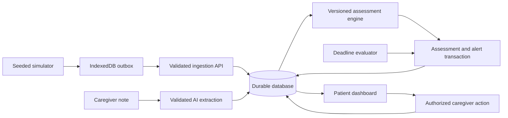

# Proposed architecture

Status: Next.js/TypeScript/PostgreSQL stack confirmed by the participant on 7 November 2026. Local milestone uses filesystem-backed PGlite (embedded PostgreSQL) because no PostgreSQL server or Docker was installed. Hosted PostgreSQL, AI, roles, and scheduler remain planned. Actual versions are pinned in package.json/package-lock.json. See [ADR-001](decisions/001-local-postgres.md).

## Default stack proposal

- TypeScript with Next.js for the interface and server API, avoiding a second backend language for a solo build.
- PostgreSQL with a familiar typed database layer for durable hosted state; local PostgreSQL for reproducible development where feasible.
- Browser simulator with IndexedDB outbox; it sends to the same ingestion API used by tests.
- Schema validation at every boundary; structured-output-capable AI provider behind a server-only adapter.
- Polling for current snapshot/history initially; introduce streaming only if justified.
- Focused unit/integration tests plus a small browser journey suite using familiar tools.

If this stack is unfamiliar, substitute a familiar equivalent before implementation. If PostgreSQL provisioning blocks progress, evaluate a persistent local SQLite demo and document hosting constraints. Do not deploy SQLite on an ephemeral filesystem and claim persistence.

## Data flow

AI calls occur outside database transactions. Persist the note first with Pending analysis; complete or fail analysis explicitly. Recompute assessment after validated extraction. Keep critical reading rules available independently of AI.

## Proposed records

| Record | Essential fields |
|---|---|
| Patient | id, synthetic label, baseline configuration version |
| DemoRun | id, seed, scenario, virtual-clock anchor, speed, startedAt |
| Reading | eventId, patientId, runId, deviceId, sequence, observedAt, receivedAt, metrics, quality flags |
| Note | id, patientId, runId, authorId, text, recordedAt, analysis status |
| NoteAnalysis | noteId, observations, source excerpts, negation/temporality, model/prompt/schema versions, failure reason |
| Assessment | id, patientId, runId, concern, evidence IDs, reasons, evaluatedAt, rules version, completeness |
| AlertEpisode | id, patientId, runId, type, severity, state, assignedActor, openedAt, acknowledgementDueAt |
| CareEvent | id, alertId, actorId, action type, reason, occurredAt, idempotency key |
| Escalation | alertId, policy version, target role, deadline, evaluatedAt, delivery status |

Store measurements with explicit units and preserve observation/receipt times separately. Add uniqueness for event identity and escalation identity. Scope reads and writes to authorized patient/run assignments.

## Proposed API contract

Current local slice implements `POST /api/readings/batch` and `GET /api/patient` (one fixed synthetic patient). The latter returns the latest reading and a bounded 60-reading history in one snapshot transaction. Patient-scoped routing, assessment, notes, and care actions below remain planned.

| Endpoint | Purpose and guarantees |
|---|---|
| `POST /api/readings/batch` | Bounded batch, per-event accepted/duplicate/rejected result; same event ID and different payload is a conflict. |
| `GET /api/patients/:id/snapshot` | Latest valid observed readings, concern, freshness, active alerts, server/run time. |
| `GET /api/patients/:id/history` | Bounded time window/pagination with stable observation-time ordering. |
| `POST /api/patients/:id/notes` | Validates size and actor; persists note before asynchronous or bounded analysis. |
| `POST /api/alerts/:id/events` | Authorizes actor, checks allowed state transition, appends audit event transactionally. |
| `GET /api/alerts` | Returns alerts visible to the current role, including overdue state. |
| `POST /api/demo/reset` | Protected operation; creates a new run rather than ambiguously merging old fixtures. |

Validation errors return structured field errors without sensitive internals. Mutations use idempotency where retries are possible. Exact response schemas are to be finalized with T02.

## Time and concurrency

- Use UTC instants in storage and explicit timezone formatting in the UI.
- Inject a clock into simulator, assessment, and escalation logic; accelerated demos must share the same virtual clock mapping.
- Reject or quarantine future readings beyond configured skew. Never silently repair their timestamps.
- Append historical readings, but recompute the current snapshot from latest valid observation time.
- Evaluate active episodes transactionally; use uniqueness/locking to prevent concurrent ingestion from opening duplicate episodes.
- Separate historical replay analysis from current alerting. Use freshness eligibility at evaluation time.

## Escalation execution

Deploy a scheduled evaluator or worker if the hosting environment supports it. It must progress without an open dashboard. Use persisted due times, idempotent writes, and observable last-run status.

A demo-only explicit time-advance/evaluate operation is acceptable for reproducibility if labeled. Request-driven polling alone is not autonomous background escalation; disclose it if used as a fallback.

## Outbox recovery

Write generated events to IndexedDB before sending. Retry only pending/retryable events with bounded exponential backoff. Remove accepted or confirmed duplicate events after the acknowledgement is durable locally. Preserve rejected events with a reason for inspection rather than retrying forever. Show queue depth and last sync.

Set a bounded queue capacity and expose overflow explicitly. Simulated disconnect blocks the transport; also test an actual failed network request. Reload must preserve pending entries.

## AI trust boundary

Treat notes as untrusted data, including embedded instructions. Request only an allowlisted observation schema; validate enums, excerpts, length, and temporal fields. Reject unsupported excerpts. Do not grant the model tools or let its text execute state transitions. Keep keys server-side, log metadata rather than raw notes, and limit retries/timeouts and input length.

## Access and deployment

Use an established authentication/session mechanism with server-enforced patient/role authorization. Demo identities may be preseeded, but roles cannot be trusted from client-supplied fields. Protect mutation endpoints against cross-site requests as appropriate to the session mechanism. Rate-limit public AI/ingestion paths and protect demo reset.

Use synthetic data exclusively. A public read-only demo can be separate from authenticated write controls. Record environment variable names in future SETUP.md; never commit values. Verify persistent storage, worker support, and deployment build before recording the video.
