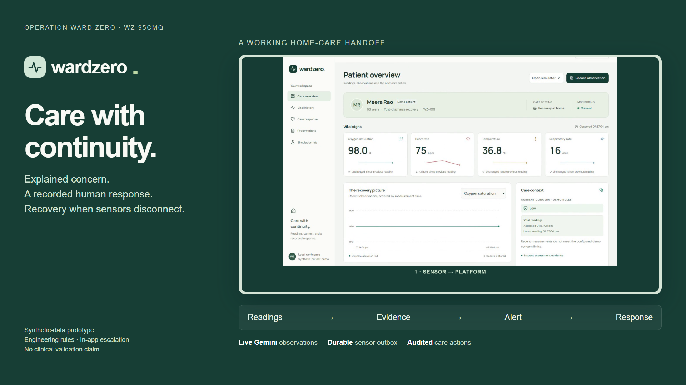

# WardZero

WardZero connects synthetic home-care vitals and English caregiver observations to explained concern, an assigned alert and an accountable caregiver response. The blue workspace has five pages: Overview, Vitals, Care response, Observations and Simulation.

[Judge guide](JUDGE_GUIDE.md) · [Run locally](SETUP.md) · [Three-minute demo](submission/wardzero-demo.mp4)

## Run and review

| Need | Documentation |
|---|---|
| Install, configure Gemini, start and test | [Setup](SETUP.md) and [environment example](../.env.example) |
| Walk through the working care flow | [Judge guide](JUDGE_GUIDE.md) |
| Understand scope and assessment rules | [Product specification](PRODUCT_SPEC.md), [care rules](CARE_LOOP_PLAN.md) |
| Inspect storage, APIs, retries and workers | [Architecture](ARCHITECTURE.md), [design decisions](decisions/) |
| Review executed checks and limitations | [Workspace verification](verification/2026-11-07-blue-pages.md), [scenario matrix](VALIDATION.md) |
| Inspect actual Gemini results and controls | [Note evaluation](verification/NOTE_EVALUATION.md), [controlled early-warning replay](verification/EARLY_WARNING.md) |
| Review model use, data and licensing | [AI/data disclosure](AI_USE.md), [third-party notices](THIRD_PARTY_NOTICES.md) |
| Reproduce the recorded demonstration | [Recording instructions](submission/RECORDING.md) |

The verified application has 73 deterministic tests and 12 Chrome journeys. Its 40-case synthetic Gemini evaluation, browser-closed escalation and accessibility evidence retain their original dates, source revisions and limits. These checks do not establish clinical accuracy or real caregiver usability. Cloud email delivery is unverified. The interactive application runs locally; Wooble submission is not claimed.

## Repository contents

Git contains application source, executable tests and fixtures, required configuration, the pinned lockfile, a placeholder environment example, the documentation above, current verification evidence and one canonical demo/cover/caption package. All substantive documentation lives in this folder.

Working plans, milestones, form answers, upload galleries, alternate films, assistant instructions and generated screenshots stay local. Dependencies, builds, databases, credentials, raw captures, caches, logs and source ZIP exports are excluded. The documentation exceptions in `.gitignore` explicitly select what is public; add an exception deliberately when publishing a new document. Earlier milestones remain available in Git history.
